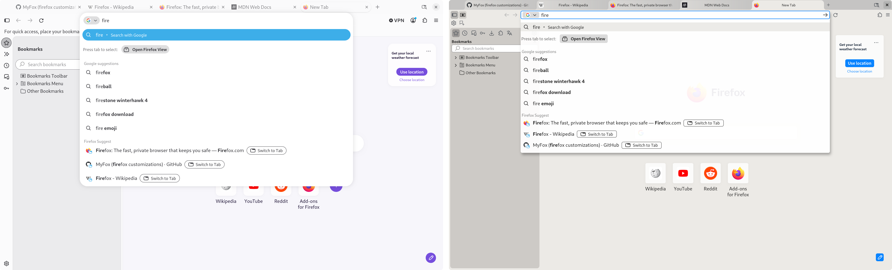
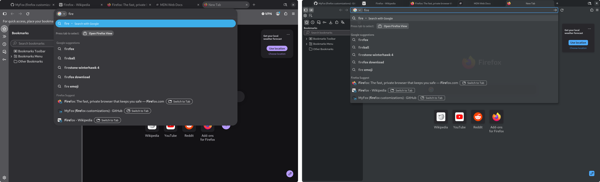

# MyFox tweaks

MyFox tweaks are my styles and settings for the Firefox interface.

I started with a few edits in userChrome.css: some found online, some written myself. With each
new Firefox something inside got renamed, the styles broke, I fixed them and added more, and
over time the edits grew into a whole set.

Now my Firefox is the way I want it. Tabs look like tabs again, not pill buttons. Downloads,
extensions, passwords and translations live in the sidebar. Menus and panels are compact and in
the theme's colors. AI features, telemetry and ads on the new tab page are off from the first
start, but they are ordinary settings you can turn back on.

  

  

## Installing

### Manual

1. Download `myfox-tweaks.tar.gz` from the [latest release](https://github.com/CustomFF/myfox-tweaks/releases/latest)
   and unpack it.
2. Copy `myfox.cfg` and the `myfox` folder from `autoconfig` into the Firefox install folder,
   and `autoconfig.js` into `defaults/pref` inside it.
3. Copy the `chrome` folder into the profile and create an empty file named `.myfox` there.
4. Restart Firefox.

Many of the interface changes are made for the MyFox themes, so they need to be installed too.
The themes are in the [Signed themes](https://github.com/CustomFF/myfox-tweaks/releases) releases
and are installed in about:addons: the gear menu → "Install Add-on From File…".

#### Finding the install folder

1. Open about:support.
2. The "Application Binary" row shows the path to the Firefox file.
3. The install folder is the folder that file is in.

If the path starts with `/snap/`, Firefox was installed from snap. Installing the tweaks into it
won't work: a snap's install folder is read-only.

If the path starts with `/app/`, Firefox was installed from flatpak, and the path is shown from
inside its sandbox. The real install folder is:

- `/var/lib/flatpak/app/org.mozilla.firefox/current/active/files/lib/firefox` for an install for
  all users; copying there needs sudo;
- `~/.local/share/flatpak/app/org.mozilla.firefox/current/active/files/lib/firefox` for an
  install for yourself only.

After every update of a flatpak Firefox, the files from `autoconfig` have to be copied again.

I suggest installing Firefox from the archive on
[Mozilla's server](https://ftp.mozilla.org/pub/firefox/releases/) instead of snap or flatpak. It
is an official way too. A Firefox installed from the official archive also updates itself.

#### Finding the profile folder

1. Open about:support.
2. The "Profile Directory" row shows the path to the profile. The "Open Directory" button opens
   it.

### Automatic

Through [MyFox](https://github.com/CustomFF/myfox).

## Removing

Delete the `.myfox` file and the `chrome/` folder from the profile folder, then restart Firefox.
Without `.myfox` the files in the install folder do nothing, but you can delete them as well.
The settings the tweaks made on the first start stay as ordinary Firefox settings, and the theme
can be changed in about:addons.
