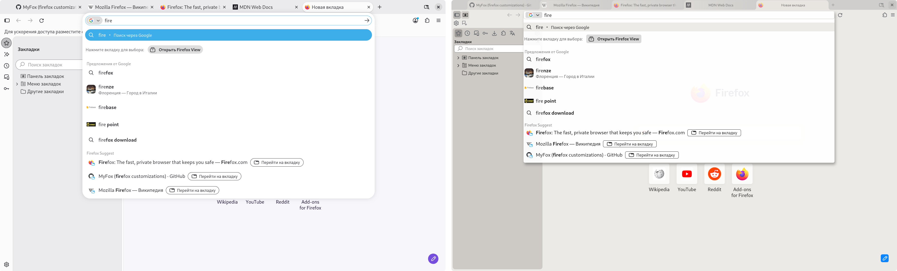
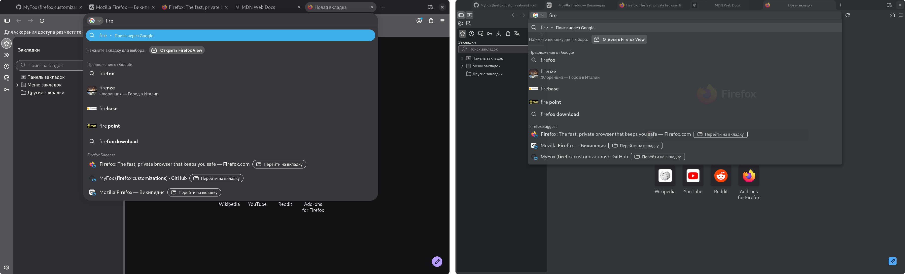

# MyFox tweaks

MyFox tweaks — мои стили и настройки для интерфейса Firefox.

Начинал я с нескольких правок в userChrome.css: что-то находил в сети, что-то писал сам.
С каждой новой версией Firefox внутри что-то переименовывали, стили ломались, я их чинил и
дописывал, и со временем правки выросли в целый набор.

Теперь мой Firefox такой, каким я хочу его видеть. Вкладки снова похожи на вкладки, а не на
кнопки-пилюли. Загрузки, расширения, пароли и переводчик живут в боковой панели. Меню и панели плотные и в
цветах темы. ИИ-функции, телеметрия и реклама на новой вкладке выключены с первого запуска, но
это обычные настройки, их можно вернуть.

  

  

## Установка

### Ручная

1. Скачайте `myfox-tweaks.tar.gz` из [последнего релиза](https://github.com/CustomFF/myfox-tweaks/releases/latest)
   и распакуйте.
2. Скопируйте `myfox.cfg` и папку `myfox` из `autoconfig` в папку установки Firefox, а
   `autoconfig.js` — в `defaults/pref` внутри неё.
3. Скопируйте папку `chrome` в профиль и создайте там пустой файл `.myfox`.
4. Перезапустите Firefox.

Значительная часть изменений интерфейса рассчитана на темы оформления MyFox, поэтому их тоже
нужно установить. Темы скачиваются из релизов [Signed themes](https://github.com/CustomFF/myfox-tweaks/releases)
и ставятся в about:addons: меню с шестерёнкой → «Установить дополнение из файла…».

#### Как найти папку установки

1. Откройте about:support.
2. В строке «Бинарный файл приложения» указан путь к файлу Firefox.
3. Папка установки — та, в которой лежит этот файл.

Если путь начинается с `/snap/`, Firefox установлен из snap. Поставить в него твики не получится:
папка установки snap доступна только для чтения.

Если путь начинается с `/app/`, Firefox установлен из flatpak, и путь показан изнутри песочницы.
Настоящая папка установки:

- `/var/lib/flatpak/app/org.mozilla.firefox/current/active/files/lib/firefox` — при установке
  для всех пользователей, копировать туда нужно через sudo;
- `~/.local/share/flatpak/app/org.mozilla.firefox/current/active/files/lib/firefox` — при
  установке только для себя.

После каждого обновления Firefox из flatpak файлы из `autoconfig` нужно копировать заново.

Советую вместо snap или flatpak ставить Firefox из архива с
[сервера Mozilla](https://ftp.mozilla.org/pub/firefox/releases/). Это тоже официальный способ.
Установленный из официального архива Firefox ещё и автообновляется.

#### Как найти папку профиля

1. Откройте about:support.
2. В строке «Папка профиля» указан путь к профилю. Кнопка «Открыть папку» открывает его.

### Автоматическая

Через [MyFox](https://github.com/CustomFF/myfox).

## Удаление

Удалите из папки профиля файл `.myfox` и папку `chrome/`, затем перезапустите Firefox. Файлы в
папке установки без `.myfox` ничего не делают, но их тоже можно удалить. Настройки, которые
твики выставили при первом запуске, остаются обычными настройками Firefox, тему можно сменить в
about:addons.
